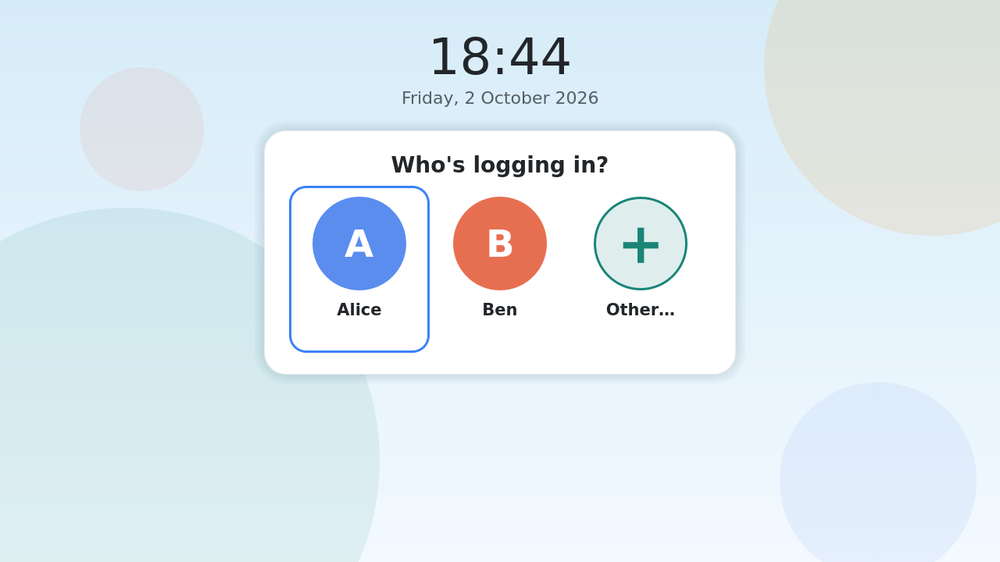
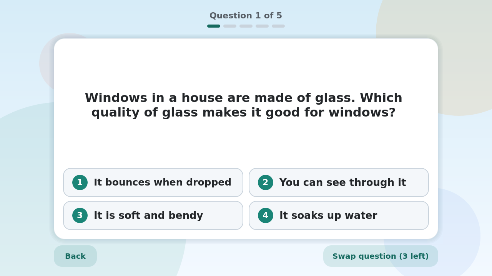
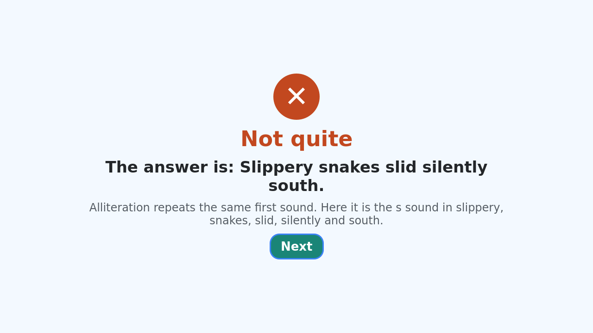
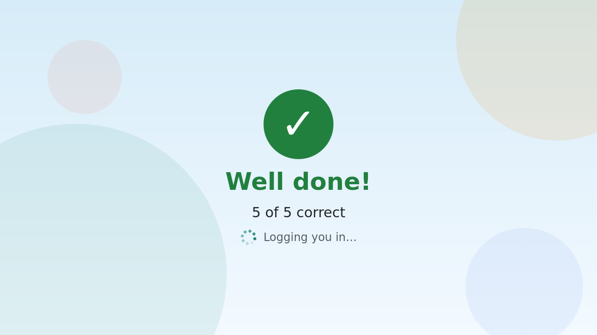
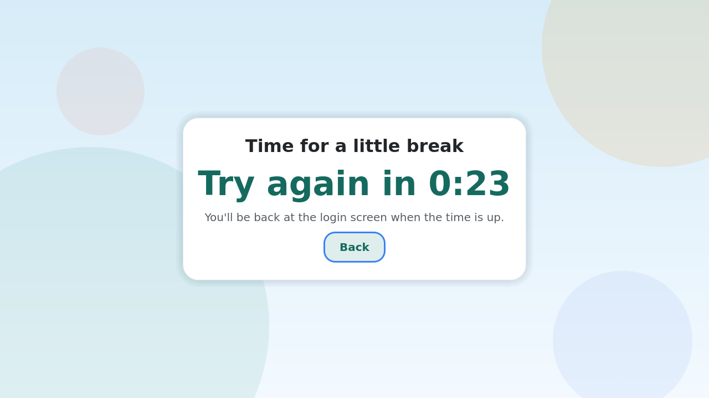

# Edu-LM

Edu-LM is a fork of [SDDM](https://github.com/sddm/sddm), the display manager KDE Plasma uses for its login screen. It adds a quiz: a child's account has to pass a short curriculum quiz before it logs in. Questions follow the Australian Curriculum v9 for Years 3 to 5 (maths, science, HASS and English).

It is for a few family PCs running Arch Linux and KDE Plasma, where a parent wants some learning before screen time. It is not a product for schools, and it is alpha software (see Status).

## How it works

- A parent puts a child's account in the `edu-students` group (and a year group, such as `edu-year4`). Parents and everyone else log in as usual, with no quiz.
- The child picks their name, then enters their password. The password is checked first. Edu-LM can also be set up with no student passwords.
- Then comes the quiz: by default 5 questions, and 4 right to pass. A child can swap a question for a new one a few times per attempt (3 by default, shared across the attempt).
- When a question is answered wrongly, the right answer and a short explanation show straight away. After a failed attempt the child sees the missed questions with their answers.
- A failed attempt is followed by a break (60 seconds by default). Then the child logs in again and gets a fresh set. The break is kept per child by the daemon, so picking another user or restarting the greeter does not reset it. A reboot or a restart of SDDM does.
- Question types: multiple choice, true or false, typed numbers, typed short answers, and generated sums (add, subtract, multiply, divide, place value).
- The root daemon holds the questions and checks the answers. The login screen (the greeter) never sees an answer key. With a login screen theme that does not know about the quiz, a quiz user cannot log in at all: it fails closed.

## Screenshots

Taken from the greeter's test mode (`tools/dev/greeter-flow.sh`), with made-up users.

| | |
|---|---|
|  |  |
| Who is logging in. | A question, with a swap button. |
|  |  |
| The right answer is shown after a miss. | The pass screen, before the session starts. |
|  | |
| The break after a failed attempt. | |

## Status

Alpha.

- Built and tested on a Raspberry Pi (Debian, aarch64): the unit tests, and the greeter in test mode under Xvfb.
- One real Arch PC has had the package installed, and a real quiz login worked: a child passed 4 of 5 through real PAM and got a session, and a missed question showed its answer.
- The rest of the real-PC test plan, [docs/PHASE4-TEST.md](docs/PHASE4-TEST.md), is still open. That includes children with no password, the optional text-console lock, the stock theme failing closed, and the autologin skip.
- Expect rough edges. Read the Limits section before you rely on it for anything.

## Install

On Arch Linux, build and install the package from a checkout: [docs/INSTALL-ARCH.md](docs/INSTALL-ARCH.md). It covers switching the display manager, adding children and groups, passwords, and rolling back.

Other distros: any distro that ships SDDM with Qt 6 should work with a plain `cmake` install. The steps are at the end of INSTALL-ARCH.md ("Other distros"). You will need to copy your distro's PAM service files, since upstream SDDM no longer installs them. It has been built on Debian (a Raspberry Pi) but only run as a login manager on Arch.

Installed with the package is `edu-lm-check` (`sudo edu-lm-check`), which checks the setup, and `edu-lm-validate`, which checks question files.

## Configuration

Settings go in drop-in files in `/etc/edu-lm/edu-lm.conf.d/` (use a `.conf` name; every non-hidden file there is read, so keep backups elsewhere). [`edu-lm.conf`](data/edu/edu-lm.conf.in) itself is comments only: every key with its default and a description. Do not edit it, because it is read last and would override the drop-ins.

| Key | Default | |
|---|---|---|
| `Groups` | `edu-students` | Groups whose members get the quiz |
| `ExemptUsers` | none | Users who never get the quiz |
| `StudentPasswords` | `true` | `false`: quiz users have no password |
| `QuestionCount`, `RequiredCorrect` | 5, 4 | Questions per attempt, and right answers needed |
| `MaxSwaps` | 3 | Swaps shared across an attempt |
| `FailCooldownSeconds` | 60 | The break after a failed attempt |
| `AnswerAttempts` | 1 | Tries per question |
| `ShowCorrectAnswers` | `true` | Show the right answer after a miss |
| `YearGroups` | `edu-year3:3,edu-year4:4,edu-year5:5` | Group to year level |
| `Subjects` | `maths,science,hass,english` | Subjects to ask about |
| `QuestionDirs` | shipped packs and `/etc/edu-lm/questions.d` | Where packs are read from |

The design is in [docs/PLAN.md](docs/PLAN.md), and progress notes are in [docs/PROGRESS.md](docs/PROGRESS.md).

## The question bank

The bank has 562 entries: 523 real questions across Years 3 to 5, and 39 samples that stay in the bank.

| Subject | Year 3 | Year 4 | Year 5 |
|---|---|---|---|
| Maths | 74 | 71 | 71 |
| Science | 30 | 29 | 29 |
| HASS | 29 | 29 | 30 |
| English | 46 | 44 | 41 |

(Counts are the 523 real questions; the samples are extra. 45 of the real entries are generators, which make many different sums.)

The questions were written by Claude Code subagents against the curriculum codes in [`tools/qgen/spec.json`](tools/qgen/spec.json). A second subagent answered each one without seeing the key (a blind check), and a person or Claude reviewed each pack before it was imported. Entries that were ambiguous, too hard to read, or near-copies of others were rejected or rewritten; [docs/PROGRESS.md](docs/PROGRESS.md) lists every one. The tooling is in `tools/qgen/` and the skill in `.claude/skills/qgen/`. It is a first pass by a language model, so some questions will still be wrong or badly pitched. Please report them.

You can add your own questions, a new subject, or a year level other than 3 to 5. See [docs/QUESTIONS.md](docs/QUESTIONS.md), which has a worked example of each question type.

## Limits

Edu-LM is a nudge, not a lock. It makes the easy path the quiz, and a determined child with a bit of knowledge can get round it. Specifically:

- **Text consoles.** Without the optional `pam_access` rule, a child can press Ctrl+Alt+F3 and log in with no quiz. The rule is shipped but not active ([INSTALL-ARCH.md](docs/INSTALL-ARCH.md) section 5). It does not cover SSH or other remote logins.
- **Screen unlock.** Locking and unlocking in KDE goes through its own lock screen, not SDDM, so unlocking does not ask a quiz. Idle logout or lock policy is up to you.
- **Changing the login screen theme.** Plasma's System Settings can switch the SDDM theme. Quiz users are then refused with an explanation, not let in. `edu-lm-check` tells you which file overrides the theme.
- **Autologin** is refused for quiz users.
- **No-password mode.** With `StudentPasswords=false` the child's account has an empty password. The empty password is accepted anywhere that uses the same PAM login chain (a text console, for example). The optional console lock covers text-console logins only; `su` and other paths are not covered.
- **Anything outside SDDM:** SSH, recovery mode, GRUB, a child with `sudo` or an admin account, or physical access, are not covered. Use normal hardening.
- **The break is held in memory.** A reboot clears it.

## Relationship to SDDM

Edu-LM is a fork. To keep merging upstream easy, the internal names stay `sddm` (the binaries, `sddm.conf`, the PAM service and the `sddm` user). New code lives in `src/edu/`, `data/edu/`, `data/themes/edu/`, `tools/` and `packaging/`. The few changes to upstream files are small and marked `EDU-LM:`. The Arch package is called `edu-lm` and `provides` and `conflicts` with `sddm`.

Upstream's README is kept as [README.sddm.md](README.sddm.md).

## Licences

| What | Licence |
|---|---|
| C++, CMake, scripts, packaging (SDDM's code and ours) | GPL-2.0-or-later ([LICENSE](LICENSE)) |
| The Edu-LM theme's QML, `data/themes/edu/` | MIT ([LICENSE.MIT](LICENSE.MIT)) |
| Upstream SDDM's theme images | CC BY 3.0 ([LICENSE.CC-BY-3.0](LICENSE.CC-BY-3.0)) |
| Upstream SDDM's QML (`components/`, the bundled themes `elarun`, `maldives`, `maya`) | MIT, from the header in each file; see each theme's own README or LICENSE for its assets (`maldives` ships a CC BY-SA 3.0 text) |
| Question packs, `data/edu/questions/*.json`, and the example pack `data/edu/examples/example-pack.json` | CC BY-SA 4.0 ([LICENSE.CC-BY-SA-4.0](LICENSE.CC-BY-SA-4.0)) |
| `packaging/arch/pam/*` | Copies of the PAM files from Arch Linux's `sddm` package; the files carry no licence notice |
| Docs (`docs/`, READMEs) and `.claude/skills/` | GPL-2.0-or-later (JSON examples in the docs follow the example pack: CC BY-SA 4.0) |
| Screenshots, `docs/screenshots/` | CC BY-SA 4.0 (they show the MIT theme with pack questions) |
| Curriculum codes (ACARA's) in the packs and `tools/qgen/spec.json` | CC BY 4.0, attributed below |

### Australian Curriculum attribution

The curriculum codes in the question packs and in `tools/qgen/spec.json` are ACARA's. The short descriptions in `spec.json` and the questions are our own paraphrases and writing. They are not ACARA's text, and ACARA has not reviewed them. ACARA's required citation (section 5 of its [copyright and terms of use](https://www.australiancurriculum.edu.au/copyright-and-terms-of-use), read in full on 2026-10-02):

> © Australian Curriculum, Assessment and Reporting Authority (ACARA) 2010 to present, unless otherwise indicated. This material was downloaded from the [Australian Curriculum website](http://www.australiancurriculum.edu.au) (Website) (accessed 30 September 2026) and was modified. The material is licensed under [CC BY 4.0 Attribution 4.0 International Deed](https://creativecommons.org/licenses/by/4.0/). Version updates are tracked in the 'Curriculum version history' section on the '[About the Australian Curriculum](https://www.australiancurriculum.edu.au/help/f-10-curriculum-overview/version-history)' page of the Australian Curriculum website.
>
> ACARA does not endorse any product that uses the Australian Curriculum or make any representations as to the quality of such products. Any product that uses material published on this website should not be taken to be affiliated with ACARA or have the sponsorship or approval of ACARA. It is up to each person to make their own assessment of the product, taking into account matters including, but not limited to, the version number and the degree to which the materials align with the content descriptions and achievement standards (where relevant). Where there is a claim of alignment, it is important to check that the materials align with the content descriptions and achievement standards (endorsed by all education Ministers), not the elaborations (examples provided by ACARA).

Our note, not ACARA's: the material was modified. The codes were taken from ACARA's Australian Curriculum v9 workbook, and the descriptions in `spec.json` are our shortened paraphrases, not ACARA's text.

Edu-LM is not affiliated with or approved by ACARA. Alignment to the curriculum has not been checked by ACARA or by a teacher. Where we have left something out (activities, things that need an image), `spec.json` lists it as not quizzable. See [tools/qgen/spec-sources.md](tools/qgen/spec-sources.md) for how the codes were checked.

## Acknowledgements

- The [SDDM](https://github.com/sddm/sddm) authors and contributors, for the display manager this is built on.
- ACARA, for the Australian Curriculum.
- The question bank and much of the code were written with Claude Code (Anthropic), under human direction and review.
